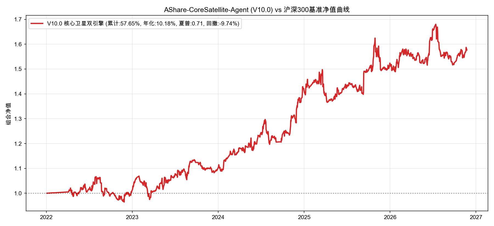

# AShare-CoreS
atellite-Agent 🚀

> **一个专为 A 股微观结构设计的“核心-卫星双引擎 + 动态交易龙头海选 + 半凯利风险平价”量化研究与个人实盘记忆智能体。**

[](https://www.python.org/)
[](LICENSE)
[]()

---

## 📊 跨周期历史回测表现 (2022–2026)

* **累计净收益**：`+57.65%`（年化收益率 `10.18%`，同期沪深300大幅震荡下行）
* **最大回撤**：`-9.74%`（卡玛比率 `1.05`）
* **微观撮合真实性**：严格内置 **T+1 锁仓机制**、**主板 10% / 创业板科创板 20% 一字涨跌停限制**，以及双边佣金与印花税摩擦损耗。

---

## 📌 项目简介

传统散户与初级量化策略在 A 股极易陷入两大误区：**一是纯左侧越跌越买“接飞刀”，二是死守过气的静态大白马名单而错过真正的主线资金共识。**

**AShare-CoreSatellite-Agent** 融合了机构级多因子风控与持久化智能体交互能力：
1. **核心-卫星双引擎架构（Core-Satellite）**：
   - **卫星进攻端**：通过全市场流动性与相对强弱（RS）海选大资金活跃且处于中期主升通道的**交易真龙头**，专抓上升途中的**缩量回踩低吸点**。
   - **核心防御端**：闲置现金自动按波动率预算配置**高股息低波红利压舱石**（如长江电力、中国神华、国有大行）及无风险货币基金，利用负相关对冲大幅压缩净值回撤。
2. **三重数学风控体系**：嵌套**市场广度择时总闸门**、**滚动半凯利公式（Fractional Kelly）**与 **ATR 波动率风险平价**，从底层逻辑杜绝重仓踩雷与情绪化抗单。
3. **实盘闭环智能体（Agent）**：内置本地 JSON 持久化持仓记忆账本、自然语言交互 CLI、精确 100 股（一手）整数倍仓位测算，以及 **Server酱微信自动推送提醒**。

---

## 🏗️ 系统架构

```text
AShare-CoreSatellite-Agent/
├── main.py                    # 统一启动入口 (交互式Agent / 历史回测 / 定时巡检)
├── config.example.yaml        # 策略参数、风控阈值与微信推送配置模板
├── core/
│   ├── data_engine.py         # 纯新浪财经抗限流双通道数据引擎 + 本地CSV缓存
│   ├── alpha_factors.py       # RS相对强弱 + 牛股缩量回头 + CLV尾盘承接因子
│   ├── risk_manager.py        # 滚动半凯利公式 + ATR波动率风险平价 + 目标波动率缩放
│   └── backtester.py          # 严格T+1/涨跌停撮合引擎 + 沪深300基准对比绘图
├── agent/
│   ├── ledger.py              # 本地持久化资金与持仓记忆账本
│   ├── notifier.py            # Server酱微信服务号推送模块
│   └── trading_agent.py       # 自然语言交互与每日尾盘止盈/止损预警雷达
└── backtest_results/
    └── v10_vs_hs300.png       # 策略 vs 沪深300基准净值对比图
```

---

## 📐 核心量化原理

### 1. 滚动半凯利仓位控制（Fractional Kelly Criterion）
系统动态统计过去 30 笔已平仓交易的真实胜率 `p` 与盈亏比 `b`，自动调节单笔进攻仓位：

```text
最优仓位比例 f* = 0.55 × max(0, p - (1 - p) / b)
```

### 2. ATR 波动率风险平价（Volatility Risk Parity）
用 14 日真实波幅（`ATR14`）约束单笔最大亏损风险暴露（设定单笔触发硬止损最多亏损总资金 `2.8%`）：

```text
波动率仓位上限 W_vol = 0.028 / (2.2 × ATR%)
```

### 3. 非对称止盈止损机制
* **宽幅防洗盘硬止损**：入场后给予 `-2.2 × ATR14` 呼吸空间，避免被主力盘中假跌破洗盘扫损；
* **三段式移动追踪锁利**：浮盈达到 `+7.5%` 后自动激活保本与移动追踪止盈线 `max(成本价 × 1.028, 最高价 - 1.3 × ATR14)`，冲高至 `+24%` 目标上限直接落袋。

---

## 🚀 快速开始

### 1. 安装依赖
```bash
git clone https://github.com/MingruGu/AShare-CoreSatellite-Agent.git
cd AShare-CoreSatellite-Agent
pip install -r requirements.txt
```

### 2. 初始化配置文件
```bash
cp config.example.yaml config.yaml
# 如需开启微信提醒，可在 config.yaml 中填入 Server酱 SendKey (https://sct.ftqq.com)
```

### 3. 运行历史回测（对比沪深300基准）
```bash
python main.py backtest
```

### 4. 启动个人量化交易智能体
```bash
python main.py
```
启动后支持直接用自然语言交互：
* **初始化资金与生成买单**：`我有100万现金，今天怎么买`
* **确认成交并记入账本**：`确认买入`
* **每日持仓止盈止损监控**：`检查持仓` 或 `该卖了吗`
* **记录卖出并进化凯利胜率**：`已卖出 300413 33.5`

### 5. 配置 macOS 每日 14:45 尾盘自动微信预警
在终端执行 `crontab -e`，添加以下定时任务：
```bash
45 14 * * 1-5 cd /你的项目路径/AShare-CoreSatellite-Agent && python main.py cron
```

---

## ⚠️ 免责声明 (Disclaimer)

**本项目仅供量化金融研究、算法学习与软件工程交流使用，不构成任何形式的实盘投资建议。**
* 历史回测业绩不代表未来实盘表现，A 股市场存在流动性波动、政策变化与个股黑天鹅风险；
* 实盘操作前建议先通过影子账户或小仓位进行充分验证，投资决策与盈亏责任由使用者自行承担。